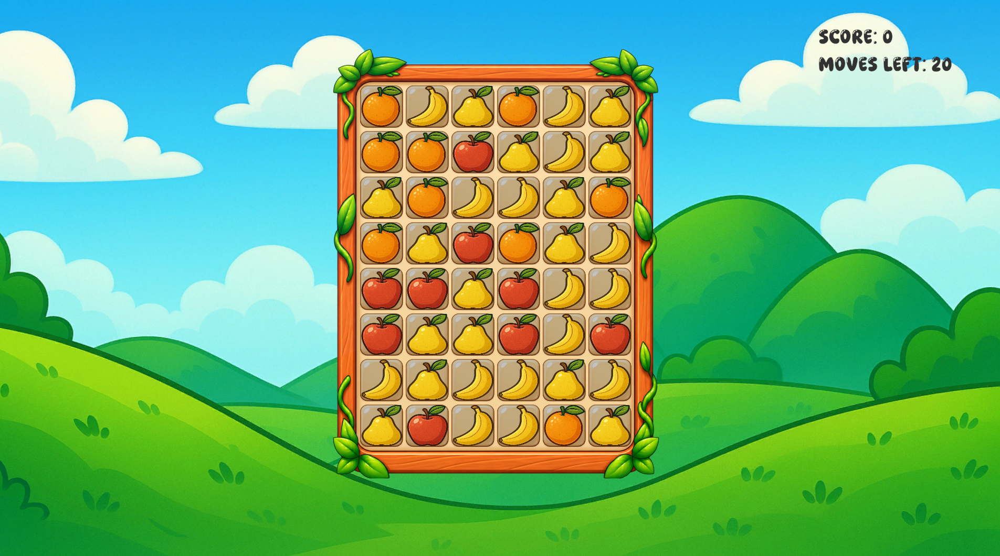
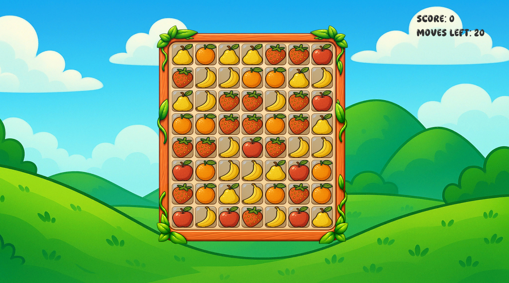
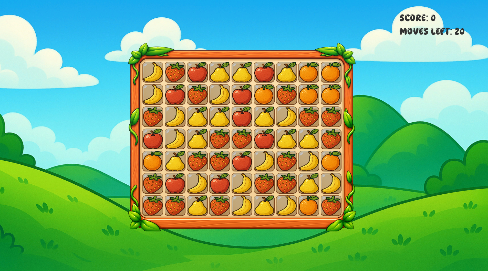
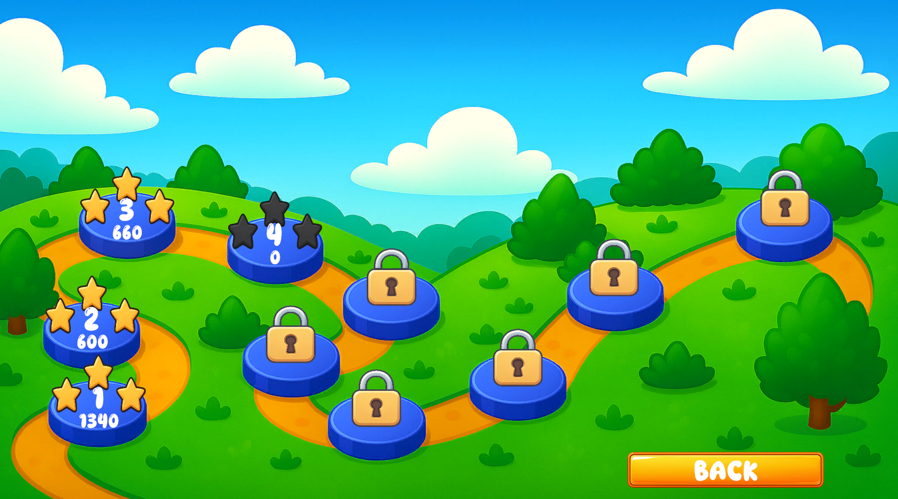

A 3-Match game that uses the basic 3-Match games rules.

## Overview

Developed a match-3 game in Unity based on the core mechanics of the genre. The game features 10 levels with progressively increasing difficulty. Unlike many commercial match-3 games, it does not include power-ups, as the primary focus of the project was implementing the core gameplay algorithms and mechanics.

## Challenges & Solutions

### Challenge 1: Core Gameplay Mechanics
**Problem**: Implementing the game mechanics in a way that prevents unintended matches and ensures consistent gameplay.

**Solution**: Implemented the core match-3 mechanics, including detecting all valid tile match combinations, removing matched tiles, spawning new tiles from the top of the board, allowing them to fall into place, and continuously checking for cascading matches until no further matches remain.

### Challenge 2: Level Generation
**Problem**: Deciding between manually designed levels and randomly generated boards.

**Solution**: Chose to generate boards using random tile placement. This introduced the challenge of preventing matches from occurring when the board is first generated. To solve this, an algorithm was implemented to validate each spawned tile and ensure that no initial matches are created.

### Challenge 3: Difficulty Progression
**Problem**: Increasing the game's difficulty while keeping each level fair and solvable.

**Solution**: Difficulty increases with each level by expanding the board size and introducing a greater variety of tile types. Each level also features a three-star rating system that rewards players based on their final score, encouraging higher performance and replayability.

## Screenshots

---

**Project Status**: ✅ Completed 
**GitHub**: [View Source Code](https://github.com/mariusvalentin189/Snack-Stack-Fruits)
**Demo**: [Play it](https://mariusdev.itch.io/snack-stack-fruits)